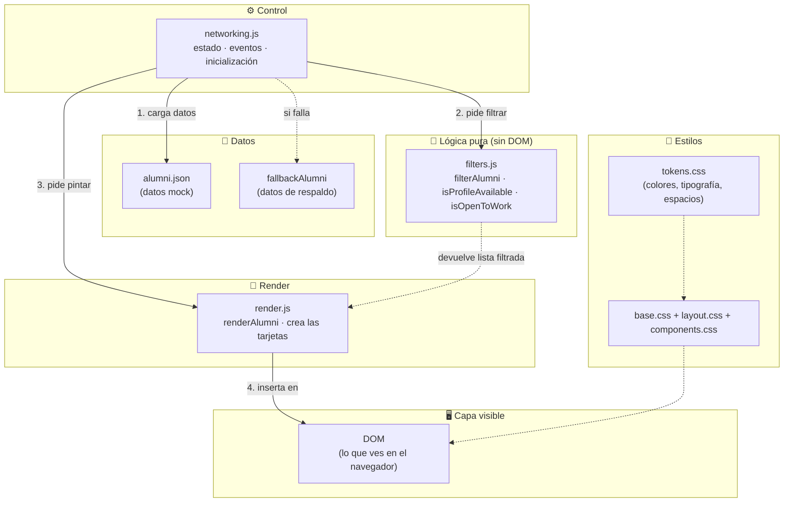
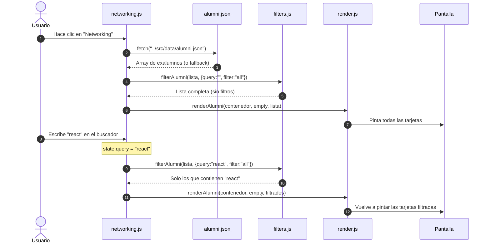

# ITAlumni — Documentación del proyecto

Un recorrido completo por cómo está construido el proyecto, escrito para que cualquiera que abra el repositorio pueda entenderlo entero sin leer cada archivo primero.

- **Demo:** SUBIR A VERCEL (PROXIMAMENTE)
- **Repositorio:** https://github.com/osbavi/itAlumni-main.git
- [ITAlumni Trello](https://trello.com/b/Yx8xAS4z/s2-italumni)

---

## 1. ¿Qué es este proyecto?

ITAlumni es una plataforma front-end de exalumnos para una academia de IT. Los graduados pueden explorar otros perfiles, consultar ofertas de empleo y seguir los eventos de la comunidad. **No hay backend**: todos los datos salen de archivos JSON mock locales, y la app simula una API asíncrona para comportarse como una real (con estados de carga, vacío y error).

Cada una de las tres secciones hace dos cosas: **muestra una lista** y te deja **buscarla y filtrarla**.

---

## 2. Stack técnico

| Herramienta                                          | Por qué                                                                               |
| ---------------------------------------------------- | ------------------------------------------------------------------------------------- |
| **HTML + CSS + JavaScript** (vanilla, sin framework) | El enunciado pedía HTML/CSS/JS sin framework.                                         |
| **CSS con custom properties**                        | Estilos rápidos y consistentes, con los colores y las fuentes definidos una sola vez. |
| **Datos mock en JSON**                               | Datos locales servidos a través de un servicio que devuelve una `Promise`.            |

---

## 3. Arquitectura general



**La idea central**: una vista (o un archivo de inicialización como networking.js) pide los datos, los pasa por una función pura de filtrado y le entrega el resultado al render. Ninguna capa se salta a otra, lo que hace cada pieza fácil de leer y de cambiar por su cuenta.

---

## 4. Flujo de datos — un ejemplo concreto

Esto es lo que pasa, paso a paso, cuando abres la sección Networking y escribes "react":



---

## 5. Estructura de carpetas

```text
pages/ # otros archivos html
src/
├── assets/icons/ # logos, iconos
├── data/ # datos mock: alumni.json, jobs.json, events.json
├── img/ # imágenes
├── scripts/ # filters.js, networking.js, render.js
├── styles/ # tokens.css, base.css, layout.css, components.css
└── index.html # punto de entrada
└── DOCUMENTATION.md #
└── README.md #
└── REPORT.md #
```

---

## 6. Las capas en detalle

## 6.1 Los datos — archivos JSON

Cada archivo contiene una lista de objetos con la misma forma. Por ejemplo, `alumni.json`:

```json
[
  {
    "id": "alu-01",
    "name": "Laura Martínez",
    "avatar": "https://i.pravatar.cc/150?img=49",
    "stack": "Front-end",
    "location": "Barcelona",
    "availability": "true",
    "skills": ["React", "TypeScript", "Tailwind"],
    "level": "Junior",
    "workSituation": "Open to work"
  }
]
```

Fíjate en dos detalles importantes:

- `availability` viene como string (`"true"` / `"false"`), no como booleano. Por eso `isProfileAvailable` acepta ambos formatos.
- `workSituation` mezcla mayúsculas y minúsculas ("Open to work", "unemployed"…). Por eso `isOpenToWork` normaliza la cadena antes de comparar.

## 6.2 La utilidad — funcion pura de filtrado

Aquí está el corazón del filtrado. La función es **pura**: recibe datos y un estado de filtros, y devuelve datos, **sin tocar el DOM**. Eso la hace fácil de razonar y fácil de testear.

```js
export function filterAlumni(alumniList, { query = "", filter = "all" } = {}) {
  const normalizedQuery = query.trim().toLowerCase();

  return alumniList.filter((person) => {
    let matchesFilter = true;
    if (filter === "available") {
      matchesFilter = isProfileAvailable(person);
    } else if (filter === "open-to-work") {
      matchesFilter = isOpenToWork(person);
    }

    if (!normalizedQuery) {
      return matchesFilter;
    }

    return matchesFilter && matchesSearchQuery(person, normalizedQuery);
  });
}
```

Y otras pequeñas funciones de apoyo, también puras:

```js
function matchesSearchQuery(person, normalizedQuery) {
  if (normalizedQuery === "disponible") {
    return isProfileAvailable(person);
  }

  if (normalizedQuery === "no disponible") {
    return isProfileUnavailable(person);
  }

  // Construir el texto buscable con los campos del perfil
  const skillsText = Array.isArray(person.skills) ? person.skills.join(" ") : "";
  const availabilityLabel = getAvailabilityLabel(person);

  const searchableText = [
    person.name ?? "",
    person.stack ?? "",
    person.level ?? "",
    person.location ?? "",
    person.workSituation ?? "",
    skillsText,
    availabilityLabel,
  ]
    .join(" ")
    .toLowerCase();

  return searchableText.includes(normalizedQuery);
}
```

```js
export function isOpenToWork(person) {
  if (
    !person ||
    person.workSituation === undefined ||
    person.workSituation === null
  ) {
    return false;
  }

  return String(person.workSituation).trim().toLowerCase() === "open to work";
}
```

```js
function getAvailabilityLabel(person) {
  if (isProfileAvailable(person)) {
    return "disponible";
  }
```

```js
export function isProfileUnavailable(person) {
  if (!person) {
    return false;
  }

  return person.availability === false || person.availability === "false";
}
```

```js
export function isProfileAvailable(person) {
  if (!person) {
    return false;
  }

  return person.availability === true || person.availability === "true";
}
```

## 6.3 El render — pintar tarjetas en el DOM

`render.js` recibe una lista de datos y crea las tarjetas HTML. No decide qué filtrar: solo pinta lo que le dan.

```js
export function renderAlumni(container, emptyStateEl, alumniList) {
  container.replaceChildren();

  if (!Array.isArray(alumniList) || alumniList.length === 0) {
    if (emptyStateEl) emptyStateEl.hidden = false;
    return;
  }
  if (emptyStateEl) emptyStateEl.hidden = true;

  for (const person of alumniList) {
    const card = document.createElement("article");
    card.className = "alumni-card";

    // …crear h3, p, img, button…

    container.appendChild(card);
  }
}
```

Puntos importantes:

- `textContent` en lugar de `innerHTML`: si un nombre tuviera `<script>`, no se ejecutaría.
- `replaceChildren()` al principio: vacía el contenedor antes de pintar de nuevo.
- Si la lista está vacía, muestra `emptyStateEl` y sale antes de crear nada.

## 6.4 El control — networking.js

Este archivo es el “pegamento” de la sección: selecciona los elementos del DOM, mantiene el estado de los filtros, escucha los eventos y llama a las otras piezas.

```js
async function initNetworking() {
  const formEl = document.querySelector(".search-bar");
  const searchInputEl = document.querySelector("#search-alumni");
  const filterButtons = Array.from(
    document.querySelectorAll(".networking__filter-btn"),
  );
  const resultsContainer = document.querySelector("#alumni-results");
  const emptyStateEl = document.querySelector("#alumni-empty-state");

  if (!resultsContainer) return;

  const state = {
    query: initialAlumniFilterState.query,
    filter: initialAlumniFilterState.filter,
  };
  const allAlumni = await loadAlumniFromJson();

  const applyFiltersAndRender = () => {
    const filtered = filterAlumni(allAlumni, state);
    renderAlumni(resultsContainer, emptyStateEl, filtered);
  };

  updateActiveFilterButton(filterButtons, state.filter);
  applyFiltersAndRender();

  // … listeners de submit, input y click…
}

document.addEventListener("DOMContentLoaded", initNetworking);
```

Lo que hace, resumido:

1. Busca en el DOM todos los elementos que necesita.
2. Carga la lista de exalumnos (o usa `fallbackAlumni` si falla).
3. Crea `applyFiltersAndRender`: filtra + pinta. Todo en un solo sitio.
4. Escucha cambios en el buscador y en los botones de filtro.
5. Cada vez que cambia algo, actualiza `state` y llama a `applyFiltersAndRender`.

La **función** `loadAlumniFromJson` se asegura de que la app no se quede vacía si el JSON no carga:

```js
async function loadAlumniFromJson() {
  try {
    const response = await fetch("../src/data/alumni.json");
    if (!response.ok) {
      throw new Error(`No se pudo cargar alumni.json (${response.status})`);
    }
    const data = await response.json();

    if (Array.isArray(data) && data.length > 0) {
      return data;
    }
    return fallbackAlumni;
  } catch (error) {
    console.warn("Usando datos de respaldo:", error);
    return fallbackAlumni;
  }
}
```

## 6.5 El sistema de estilos — CSS con tokens

Los estilos están divididos en cuatro archivos, cargados en este orden:

| <center>Archivo</center> | <center>Contiene</center>                                      |
| ------------------------ | -------------------------------------------------------------- |
| `tokens.css`             | Variables CSS: colores, tipografía, espacios, radios, sombras. |
| `base.css`               | Reset, tipografía base y utilidades de accesibilidad           |
| `layout.css`             | Estructura general: header, footer, grids, responsive.         |
| `components.css`         | Piezas concretas: botones, tarjetas, buscador, filtros.        |

Las **variables** están declaradas en :`root` dentro de `tokens.css`:

```css
:root {
  --color-primary: #df007f;
  --color-text-main: #141419;
  --space-4: 1rem;
  --radius-md: 0.75rem;
  --text-base: 1rem;
  --font-primary: "Inter", system-ui, sans-serif;
}
```

Así, si mañana cambia el color de marca, se toca **una sola línea** y toda la app se actualiza.

---

## 7. Conceptos clave utilizados

- **Funciones puras.** Los filtros reciben datos y devuelven datos sin efectos secundarios. Eso los hace predecibles y listos para test.
- **Separación de responsabilidades.** Datos / lógica / render / estilos viven en archivos distintos, cada uno con un único trabajo.
- **Fallback de datos.** Si el JSON falla, la app sigue funcionando con datos de respaldo.

---

## 8. Funcionalidades por sección

| <center>Sección</center> | <center>Buscar por </center> | <center>Filtrar por</center>       |
| ------------------------ | ---------------------------- | ---------------------------------- |
| **Alumni**               | nombre o skill               | todos / disponibles / open to work |
| **Ofertas**              | título o empresa             | stack, tipo de contrato, ubicación |
| **Eventos**              | título                       | tipo (charla / taller)             |

Todas las secciones manejan estados de carga, vacío y error, y el layout es responsive (nav superior en escritorio, barra inferior en móvil).

---

## 9. Flujo de trabajo con Git (VER)

El proyecto sigue Git Flow:

`main` — la versión final, desplegable (construye desde aquí).
`develop` — la rama de integración donde se juntan las funcionalidades.
`feature/*` — una rama por tarea, que se integra en `develop` a través de un pull request.

Los mensajes de commit siguen el estilo convencional: `feat`, `fix`, `refactor`, `chore`, `docs`.

---

## 10. Cómo ejecutar el proyecto

**Favoritos** (guardar en `localStorage`) — el nivel 3 opcional, se dejó fuera a propósito.
**Eventos** Realizar sección eventos y más filtros
**Tests unitarios** con Vitest para las funciones de filtrado, que ya son puras y están listas para testear.
Un **backend/API** real en lugar de JSON mock, y un filtro de fechas para los eventos.

---

_ITAlumni — Proyecto 1, curso Front-End de IT Academy (Barcelona Activa). Autor: Oscar Ballart._
